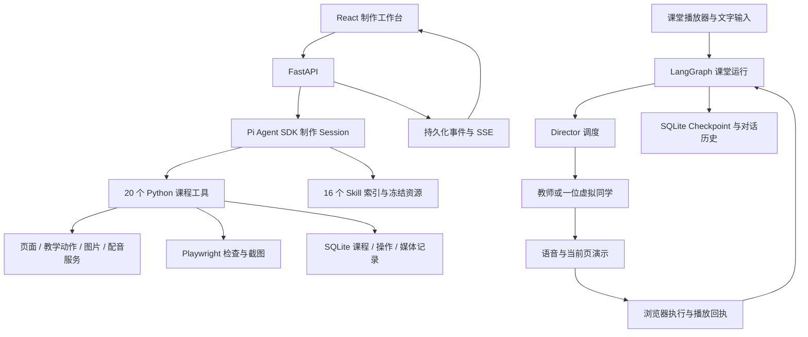

# ClassroomAgent · 在线课堂 Agent

通过自然语言制作、修改和学习可交互的数字课程。系统将课程页面、教学动作与配音分别生成和保存，支持 AI 教师讲解、三位虚拟同学参与圆桌讨论、数值实验和基础测验。

ClassroomAgent 是一个集课程制作、内容编辑和课堂互动于一体的 AI 教学应用。**Pi Agent SDK** 驱动课程制作 Agent，**LangGraph** 调度教师与虚拟同学的实时互动，**FastAPI + React** 提供制作工作台与课堂播放器。

输入教学主题与学习目标，即可逐步制作包含课程页面、讲稿、配音、数值实验和测验的网页课程，并在课堂中向 AI 教师提问、与虚拟同学讨论。

## 核心能力

| 能力 | 实现 |
| --- | --- |
| 自然语言制作 | 先确认课程方案，再逐页生成页面、讲稿、教学动作与配音 |
| 多课程编辑 | 同一制作对话可查询和编辑多门课程；写入前核实课程、页面和版本 |
| 定向修改 | 分离课程名称、页面目录与单页正文的编辑接口，保留未修改内容 |
| 教师讲解 | 按保存的动作播放语音，配合聚光、激光和实验参数操作 |
| 圆桌讨论 | 教师与好奇宝宝、笔记员、思考者按上下文动态接话，调度器决定等待或结束 |
| 实验与测验 | 数值参数模拟、预设与重置；基础单选测验、判题和解析 |
| Skill 渐进加载 | 16 个内置 Skill，索引发现、`/` 选择、分页读取及本轮资源快照 |
| 质量检查 | 浏览器程序检查、真实截图视觉结论、媒体文件状态与检查指纹 |
| 持久化与恢复 | SQLite、SDK Session、LangGraph Checkpoint 与事件历史；中断后保留已保存成果 |

## 快速开始

### 1. 环境要求

- Python **3.12+**。
- Node.js **22.19+**，满足 Pi Agent SDK 的版本要求，并支持直接运行项目内 TypeScript 文件。
- [uv](https://docs.astral.sh/uv/) 与 npm。
- Playwright Chromium，用于页面截图与程序检查。
- 自行配置模型与媒体服务的 API Key。真实生成、搜索和配音可能产生供应商费用。

### 2. 获取代码与安装依赖

```sh
git clone https://github.com/BistuDu/ClassroomAgent.git
cd ClassroomAgent

UV_CACHE_DIR="$PWD/.uv-cache" uv sync --locked
npm ci --ignore-scripts --cache "$PWD/data/npm-cache"
PLAYWRIGHT_BROWSERS_PATH="$PWD/data/browsers" .venv/bin/python -m playwright install chromium
cp .env.example .env
```

私有仓库需要先取得访问权限。以上命令采用 macOS/Linux shell 写法；所有后续命令均在仓库根目录执行。Windows 用户需要按所用 shell 调整环境变量和虚拟环境可执行文件路径。

#### Pi Agent SDK 如何安装？

Pi Agent SDK 对应 npm 包 `@earendil-works/pi-coding-agent`，已列入 `package.json`，当前由 `package-lock.json` 锁定为 **1.0.2**。上面的 `npm ci` 会将 SDK、前端依赖及其传递依赖一并安装到本机 `node_modules/`，不需要额外安装全局 Pi CLI。

`node_modules/` 是安装生成的目录，不上传 Git。仓库保留 `package.json` 和 `package-lock.json`，其他人克隆后，或本机删除依赖目录后，在仓库根目录执行以下命令即可恢复全部 Node 依赖：

```sh
npm ci --ignore-scripts --cache "$PWD/data/npm-cache"
```

安装后可检查 SDK 版本与模块加载是否正常：

```sh
npm ls @earendil-works/pi-coding-agent
node --input-type=module -e 'await import("@earendil-works/pi-coding-agent"); console.log("Pi Agent SDK 加载成功")'
```

SDK 桥接代码保存在 `agent-runtime/`，会随项目提交；它通过公开 SDK 接口运行，无需手动修改 `node_modules/`。Python 依赖由 `uv sync --locked` 恢复，Chromium 则通过上述 Playwright 命令单独安装。

### 3. 配置服务

编辑 `.env`。示例文件中的服务和模型名称是配置样例，实际可用性由供应商及账户决定；不代表项目会提供密钥或免费额度。

| 配置组 | 用途 |
| --- | --- |
| `CREATION_PROVIDER/BASE_URL/MODEL/API/API_KEY` | Pi 制作 Agent，以及页面和教学动作生成模型 |
| `CLASSROOM_PROVIDER/BASE_URL/MODEL/API/API_KEY` | 可选的实时课堂模型；未设置此组时整体沿用制作模型 |
| `IMAGE_PROVIDER/BASE_URL/MODEL/API_KEY` | 图片生成；下载域名配置见 `.env.example` 的 `IMAGE_MEDIA_HOSTS` |
| `BAILIAN_API_KEY/BASE_URL/TTS_MODEL/TTS_VOICE` | 百炼配音服务与兼容的预设音色 |
| `TAVILY_API_KEY` | 搜索与远程网页正文提取 |
| 端口与访问地址 | 见 `.env.example` 中的端口和 origin 配置，两者需对应 |

配置名称中的 `BASE_URL` 等均以对应前缀展开，例如 `CREATION_BASE_URL`。制作与课堂支持 `openai-completions` 和 `openai-responses` 两类协议，具体功能取决于模型和供应商支持。

- 显式启用制作或课堂配置组时，应填写完整配置，避免混用服务地址和密钥。
- 截图视觉判断需要制作模型支持图片输入；仅支持文本的模型不能完成相同验收。
- 现有 TTS 使用百炼 Qwen3 HTTP 模型，不是任意供应商的通用语音接口。
- `.env` 只保存在本机；前端文件与 Git 提交中不要写入真实密钥。

### 4. 构建并启动

```sh
npm run build
npm start
```

按照 `.env.example` 的默认端口，打开 **http://127.0.0.1:8001/**。后端同时提供 API 与构建后的前端资源。

如果修改端口，请同步更新 `.env` 中的端口和 origin 地址配置。启动日志提示端口已占用时，需要先确认占用进程或选择另一个端口。

### 5. 前端开发模式

两个终端分别执行：

```sh
# 终端 1：后端
npm start
```

```sh
# 终端 2：Vite 前端
npm run dev
```

打开 Vite 打印的本地地址。默认使用 5173 端口，`/api` 转发至 `.env` 配置的后端。程序检查与截图仍需要已构建的 `frontend/dist`，前端热更新不能替代检查所需构建。

## 使用示例

### 制作一门课

在制作对话中输入：

> /workshop-style 为初中生制作一节光的折射实验课，包含概念说明、可调入射角的实验和三道单选题。

Agent 先提出课程方案，通过确认卡取得批准，再执行制作。工具卡与时间线展示真实 SDK 事件、参数、结果及页码信息。

```text
明确受众和学习目标
 → ask_user 确认方案
 → create_stage 创建课程
 → generate_scene 逐页生成内容
 → generate_actions 生成讲稿与教学动作
 → generate_tts 合成配音
 → check_scene(program) 执行程序检查
 → render_scene_preview 获取真实截图
 → check_scene(visual) 保存截图观察结论
 → list_scenes 核对当前版本的课程状态
```

`generate_scene` 不会自动生成讲稿或配音；重做页面后需要补齐后续环节。只重做讲解时使用 `generate_actions`，独立补音或重做音频使用 `generate_tts`。

### 修改已有课程

可以直接用自然语言描述，例如：

- “把光学实验课改名为光的传播与折射。”
- “把第二页标题改成光为什么会转弯。”
- “只修改第三页的讲稿，保留画面，并重新配音。”

Agent 通过 `list_stages`、`list_scenes` 与 `read_stage` 定位课程和页面，读取当前版本后执行修改。

`expectedRevision` 是并发保护：版本与当前课程不一致时拒绝写入，要求重新读取；它不会选择或恢复历史版本。页面目录查询和首次写入也不会自动要求重做整门课程。

### 进入课堂

打开课程进入课堂，按预制教学动作播放。你可以文字提问；到预设讨论点时选择参与或跳过。

- 调度器根据问题、当前页证据和对话历史选择下一位角色，或等待你、结束话题。
- 同学只发言；教师演示工具按角色和当前页面类型提供。
- 实验操作以浏览器实际回执为依据，不能把工具请求当作执行成功。
- 互动后由你明确继续讲课；互动中切页会先请求确认。
- 播放位置、答题状态和课堂对话分别持久化；刷新或重启恢复不会自动发声。
- 讨论轮次由调度器决定，并受生成时间、工具调用及防重复等运行预算约束。

## 架构



制作与课堂是两条不同链路：Pi SDK 负责自主课程制作与工具调用，LangGraph 负责课堂中的实时角色互动。页面及讲稿生成工具内部会请求内容生成模型；教学要求通过页面 `brief` 和动作 `guidance` 传递。

## 20 个课程制作工具

以下分组用于说明能力，不是代码中的工具权限分类。完整参数契约位于 [`backend/tool_args.py`](backend/tool_args.py) 和 [`contracts/schema.json`](contracts/schema.json)。

| 能力 | 工具 |
| --- | --- |
| 用户决策 | `ask_user` |
| 制作规范与资料 | `read_skill`、`web_search`、`fetch_url` |
| 课程查询 | `list_stages`、`read_stage`、`grep_stage`、`list_scenes` |
| 创建与编辑 | `create_stage`、`rename_stage`、`edit_deck`、`patch_stage` |
| 内容与素材生成 | `generate_scene`、`generate_actions`、`generate_image` |
| 教师声音与配音 | `list_voices`、`set_teacher_voice`、`generate_tts` |
| 预览与检查 | `render_scene_preview`、`check_scene` |

三个编辑接口的职责：

- `rename_stage`：课程名称及描述。
- `edit_deck`：页面插入、删除、排序、标题、brief 和来源绑定。
- `patch_stage`：单个已有页面的内容与教学动作；另保留独立主题补丁，不能与页面操作混用。

写入在服务端校验归属、真实目标、版本、占用和实际影响范围。操作记录保存请求参数哈希；同一请求的已完成结果可重放，参数变化拒绝，未知付费结果不会自动重新请求。

## 16 个内置 Skill

| 用途 | Skill |
| --- | --- |
| 制作与编辑 | `stage-design`、`pro-editing` |
| 页面设计与文档结构 | `slide-craft`、`slide-dsl`、`stage-dsl` |
| 讲授、实操与实验 | `lecture-style`、`workshop-style`、`deep-interactive` |
| 调研与事实核查 | `deep-research`、`fact-check` |
| 教学方法 | `feynman-learning`、`understanding-by-design`、`zone-of-proximal-development`、`learning-to-learn`、`social-emotional-learning`、`k12-core-literacy-planning` |

- 前端输入 `/` 可选择 Skill，Agent 也可按任务需要读取。
- 系统先提供名称和描述索引，正文及参考文件通过受限 `read_skill` 按需加载。
- 每轮固定资源快照，重载只影响后续运行，避免分页拼接不同版本。
- 正文读取默认 30,000 个 Unicode 字符，单次上限 50,000；通过 `nextOffset` 续读。
- 当前请求显式选择或实际开始读取的 Skill 成为加载依赖；正文的版本、连续覆盖、字节数及哈希通过校验后，才放行依赖的生成或写入。
- 完整性校验说明正文已进入有效模型上下文，不代表模型必然遵守所有教学要求。
- Skill 提供教学方法与制作规范，不执行 Bash 或其他脚本；内部生成提示词位于 `generators/`。

Skill 的资源索引与加载实现见 [`agent-runtime/README.md`](agent-runtime/README.md)。

## 课程就绪与检查边界

[`CourseStatus`](backend/course_status.py) 根据当前真实状态计算就绪情况，包含批准页面是否齐全、是否有讲解、配音签名及文件是否有效、程序与视觉检查是否适用于当前版本并通过。

| 检查 | 判断内容 |
| --- | --- |
| 程序检查 | 课程结构、动作目标、媒体可读性、真实渲染的越界与溢出，以及实验控件和执行协议等 |
| 截图视觉检查 | Agent 观察真实截图后提交结论，绑定截图及当前页面指纹 |
| 配音有效性 | 讲稿与教师配置签名一致，音频状态就绪且文件存在 |
| 检查报告有效性 | 页面及检查依赖的指纹与报告一致，修改后不能沿用失效结论 |

获取截图本身不表示检查通过；视觉检查不是独立自动评分器。课程就绪也不等于事实全部正确或学习效果已经得到验证，事实核查需额外证据。

## 目录结构

```text
ClassroomAgent/
├── backend/          Python API、课程工具、课堂图与持久化
├── agent-runtime/    Pi SDK 桥接、事件、Skill 发现与加载校验
├── frontend/         React 工作台、播放器、实验桥与课堂对话
├── contracts/        共享 JSON Schema 与 TypeScript 类型
├── generators/       按页面类型加载的生成提示词
├── skills/           内置 SKILL.md 与按需参考资源
├── scripts/          维护及独立验收脚本
├── tests/            Python 合同测试与 Node 检查
├── docs/             架构、迁移说明及历史验收摘要
├── .env.example      无密钥的配置样例
├── pyproject.toml    Python 项目定义
├── uv.lock           Python 依赖锁
├── package.json      Node 依赖与运行命令
└── package-lock.json Node 依赖锁
```

运行时自动建立 `data/`，保存 SQLite、媒体、日志、Pi Session 和课堂 Checkpoint。运行数据、`.env`、依赖目录与构建产物不进入仓库。发布代码时保留依赖清单与锁文件，安装后重新构建前端即可运行；迁移已有课程时需要另行备份和恢复 `data/`。

## 验证与常见问题

常用开发命令（真实媒体验收脚本需要单独配置服务，可能付费）：

```sh
.venv/bin/python -m backend.export_contracts
npm run build
.venv/bin/python -m unittest discover -s tests
```

课程制作与课堂上下文的验收记录见 [`docs/task-free-runtime-acceptance.md`](docs/task-free-runtime-acceptance.md) 和 [`docs/classroom-context-pointer-acceptance.md`](docs/classroom-context-pointer-acceptance.md)。真实模型和媒体验收需要对应服务配置。

| 问题 | 处理 |
| --- | --- |
| 缺少 Pi SDK 或提示模块找不到 | 在仓库根目录执行 `npm ci --ignore-scripts --cache "$PWD/data/npm-cache"`，并检查 Node.js 是否为 22.19+ |
| 前端尚未构建 | 执行 `npm run build`，再启动后端 |
| Chromium 不可用 | 按快速开始安装项目内浏览器，检查依赖和目录权限 |
| 配置缺失或 HTTP 401/403 | 检查对应服务组、区域、模型和密钥 |
| 页面修改后配音未就绪 | 补齐受影响讲稿的配音，再检查当前版本 |
| 检查报告已过期 | 修改了相关依赖，需要重新检查；不是文件按时间自动过期 |
| 版本冲突 | 重新读取当前课程，再按新版本提交修改 |
| 付费请求结果未知 | 先核实已有记录或结果地址，不自动重复请求；明确重做才强制重试 |
| 服务重启后课堂暂停 | 已保存成果与历史保留，用户明确恢复后继续，不自动播放 |

## 当前范围

- 本地单用户应用，默认只监听 `127.0.0.1`；没有公网多人身份认证与租户隔离的完整部署方案。
- 页面支持普通 slide、数值模拟 interactive 与基础单选 quiz。
- 课堂固定一位教师与三位 AI 同学，同学只发言。
- 不提供 PPTX 导入导出、任意代码执行、3D/game 引擎或个人 Skill 创建工具。
- 模型、搜索、图片和语音需要外部服务；并非离线应用。

## 许可

许可与版权信息见 [`LICENSE`](LICENSE)，第三方资源说明见 [`ATTRIBUTION.md`](ATTRIBUTION.md)。各依赖遵循各自的许可。
